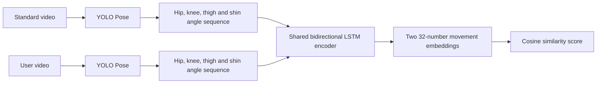

# LSTM movement comparison

## Purpose

The comparison system uses YOLO Pose to extract body points from a standard rehabilitation video and a user's video. A Siamese LSTM then compares the two movement sequences over time.

## Model input

Each video is converted to 96 time steps. Every time step contains 16 values:

- Eight normalized angles: left and right hip angle, knee angle, thigh tilt and shin tilt.
- Eight visibility values showing whether each angle was supported by confident YOLO keypoints.

The visibility values help the LSTM handle frames where a joint is hidden or outside the camera view.

## Model

- Type: Siamese bidirectional LSTM
- Shared encoder: two LSTM layers
- Hidden size: 64 in each direction
- Output: 32-number normalized movement embedding
- Comparison: cosine similarity between the standard and user embeddings
- Training loss: contrastive loss for same-movement and different-movement pairs

The angle graph still uses dynamic time warping to align both movements for explanation. The primary score comes from the LSTM.

## Current prototype data

- 20 rehabilitation clips
- 12 movement groups
- Positive pairs: two augmented versions of the same movement group
- Negative pairs: clips from different movement groups
- Augmentations: speed changes, small angle noise, left/right mirroring and short simulated keypoint dropouts

The saved model is `models/leg_rehab_siamese_lstm.pt`. The prototype's augmented-pair check reached 94.2% accuracy. This is not an independent patient-level test because all original clips come from one source demonstrator.

## Files

- `dataset_tools/lstm_motion.py`: feature conversion and LSTM architecture.
- `dataset_tools/train_siamese_lstm.py`: training workflow.
- `dataset_tools/compare_rehab_videos.py`: YOLO, LSTM scoring and comparison outputs.
- `compare_rehab_videos.command`: double-click interface.

## Data needed next

Collect consenting recordings from multiple participants performing the same exercises. Each recording should have an exercise label and a qualified review label such as `correct`, `knee_moves_inward`, `range_too_small`, `unstable` or `uncertain`. Split training, validation and test data by participant so the same person never appears in more than one group.

The current score measures visible 2D movement similarity. It must not be presented as a medical diagnosis or proof that an exercise is safe.
